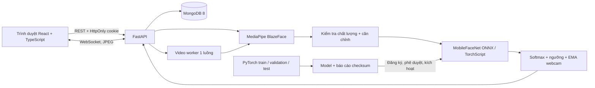
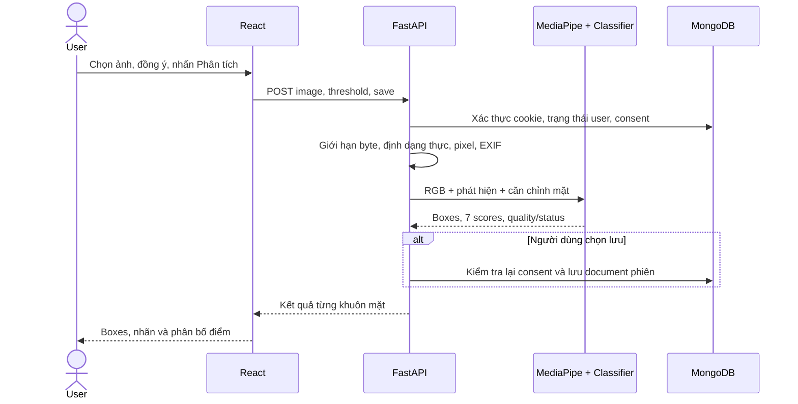
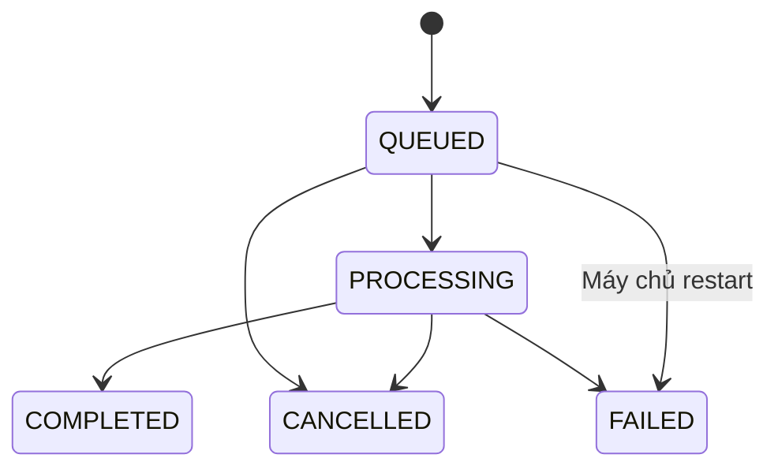

# Phân tích và thiết kế hệ thống

## Mục tiêu và phạm vi

Phát hiện khuôn mặt rồi phân loại 7 biểu cảm quan sát được: angry, disgust, fear, happy, neutral, sad, surprise. Ba nguồn vào: ảnh, video, webcam. Tài khoản, phiên và kết quả được quản lý trên MongoDB. Không có chức năng nhận dạng danh tính.

## Kiến trúc



Chạy local: frontend Vite tại 5173 (`npm start`), backend FastAPI tại APP_PORT mặc định 8010 (`npm run dev`), MongoDB Community Server hoặc Atlas theo MONGO_URI. npm gọi đúng Python 3.11 trong `.venv`, không cần Docker hay kích hoạt venv thủ công. Khi build production, FastAPI phục vụ frontend tĩnh. Docker Compose app/MongoDB là tùy chọn. Hàng đợi video một worker; training là tiến trình con khi đã cài bộ nghiên cứu. Đây là kiến trúc local/đồ án, chưa phải cụm xử lý phân tán.

## Actors và quyền

| Actor | Quyền |
|---|---|
| User | Phân tích, quản lý phiên của mình, phản hồi, quản lý đồng ý và dữ liệu |
| Admin | Quyền User, quản trị tài khoản, nhật ký và quyền nghiên cứu |
| Engineer | Quyền User, dataset, training, đăng ký/phê duyệt/kích hoạt model |
| Annotator | Quyền User, xem và đánh dấu phản hồi đã xem/từ chối |

API kiểm tra quyền độc lập với nút giao diện. User không truy cập phiên của người khác dù biết ID. Quản trị tổng hợp số liệu nhưng không được đọc nội dung phiên qua endpoint lịch sử của người khác.

## Luồng ảnh



## Trạng thái video



Upload kiểm tra suffix, dung lượng, decoder kiểm tra dữ liệu thực, duration/FPS/resolution giới hạn. Tiến độ lưu MongoDB, frontend poll theo giây. Cancel/thu hồi đồng ý/khóa tài khoản được kiểm tra ở mỗi frame. File tạm xóa trong finally; file sót do crash được dọn khi app khởi động. Kết quả tạm trả qua job trong tối đa một giờ, lịch sử dài hạn chỉ lưu khi chọn save.

## Webcam

Cookie đăng nhập và Origin được kiểm tra trước WebSocket. Consent và phiên đăng nhập kiểm tra lại mỗi frame. Frontend gửi một JPEG sau khi nhận kết quả trước, không tích tụ yêu cầu. Backend giới hạn 2 MB/message, 600 kết quả/phiên và timeout chờ 30 giây. IoU ghép khuôn mặt giữa hai frame, EMA scores giảm dao động; ID chỉ tồn tại trong phiên.

No face xóa ngay kết quả trước. Frontend mất phản hồi 10 giây sẽ xóa nhãn, dừng và đóng camera. Dừng webcam ngừng timer, đóng MediaStream; server chỉ lưu khi nhận lệnh stop và save được bật. Rời trang không lưu tự động.

## Thiết kế MongoDB

### users

```json
{"id":"hex24","email":"unique@example.com","name":"Tên","password_hash":"salt:scrypt","role":"user","status":"active","consent":false,"created_at":"BSON UTC date"}
```

### sessions — aggregate root

```json
{
  "id":"hex24", "user_id":"hex24", "source_type":"image|video|webcam",
  "title":"sample.jpg", "model_id":"opencv-mobilefacenet-v1", "status":"COMPLETED",
  "created_at":"BSON date", "expires_at":"BSON date + 30d", "duration_ms":0,
  "frame_count":1, "face_count":1, "counts":{"happy":1},
  "frames":[{"timestamp_ms":0,"width":512,"height":512,"model_id":"...","latency_ms":11,
    "status":"COMPLETED", "faces":[{"face_id":1,"box":[177,82,95,95],"expression":"happy",
      "score":0.9,"scores":{"angry":0.01,"disgust":0.01,"fear":0.01,"happy":0.9,"neutral":0.03,"sad":0.02,"surprise":0.02},"quality":"OK","status":"OK"}]}]
}
```

Nhúng kết quả thay cho bảng analysis_results: truy cập theo phiên, xóa nguyên tử document, đơn giản TTL. Để tránh giới hạn BSON 16 MB, video tối đa 180 giây ở 2 FPS và tối đa 10 mặt/frame; webcam tối đa 600 frames. Không lưu ảnh dưới dạng base64 trong database.

### Các collection khác

| Collection | Trường chính / mục đích |
|---|---|
| auth_sessions | token_hash unique, user_id, expires_at TTL |
| jobs | user_id, trạng thái, progress, cancel_requested, kết quả tạm, expires_at TTL |
| feedback | session_id, frame_index, face_id, suggested_label, reviewer, expires_at TTL |
| consents | user_id, purpose, policy_version, granted, created_at; lịch sử append |
| model_versions | id unique, engine, path, metrics, trạng thái evaluated/approved |
| datasets | tên, version, path, source, license_info, audit fingerprint |
| training_runs | dataset_id/fingerprint, config, trạng thái, history trên filesystem |
| audit_logs | actor_id, action, resource, created_at |
| data_requests | yêu cầu xóa kết quả tự phục vụ, status COMPLETED |
| system | active_model ID |

MongoDB không tự cưỡng chế foreign key. Backend lấy chủ sở hữu từ token, kiểm tra session trước thao tác và xóa feedback liên quan. TTL phản hồi dùng cùng expires_at phiên để không giữ vô hạn sau xóa tự động. Consent, audit, tài khoản không dùng TTL kết quả vì phục vụ quản lý tài khoản; chức năng “xóa dữ liệu phân tích” không xóa tài khoản.

### Index

`users.email` unique; `auth_sessions.token_hash` unique; `sessions(user_id,created_at)`; TTL trên expires_at của session/auth/job/feedback; index consent theo user/time; unique model_versions.id. Model binaries nằm trong volume model-data được khởi tạo từ image, nên clone Git không cần tải model trước ở host.

## Chất lượng đầu vào và kết quả

- Face detector confidence tối thiểu 0.5.
- Mặt dưới 40px hoặc Laplacian variance dưới 12: LOW_QUALITY; không chạy classifier.
- Max softmax dưới threshold hoặc chênh top-2 dưới .10: UNCERTAIN, expression=null.
- Không có mặt: NO_FACE; không tạo nhãn.
- Model không tải được: HTTP 503/health failed; không dùng ngẫu nhiên.

Các ngưỡng trên đều là tham số kỹ thuật khởi đầu, chưa được hiệu chỉnh khoa học trên tập validation của dự án.

## Bảo mật và dữ liệu

Scrypt cho mật khẩu; opaque token chỉ lưu SHA-256; HttpOnly SameSite strict cookie; rate limit login 10 lần/5 phút mỗi IP+email; kiểm tra Origin cho mutation và WebSocket. API RBAC/ownership tại backend. MongoDB có xác thực và không publish port host. Server bind host port 127.0.0.1.

Triển khai Internet cần HTTPS, `COOKIE_SECURE=true`, allowed origins chính xác, backup, chính sách quyền dữ liệu, TLS MongoDB và worker/hàng đợi bền vững. Bản giao là ứng dụng nghiên cứu chạy local; không công bố đáp ứng đầy đủ nghĩa vụ pháp lý production.
